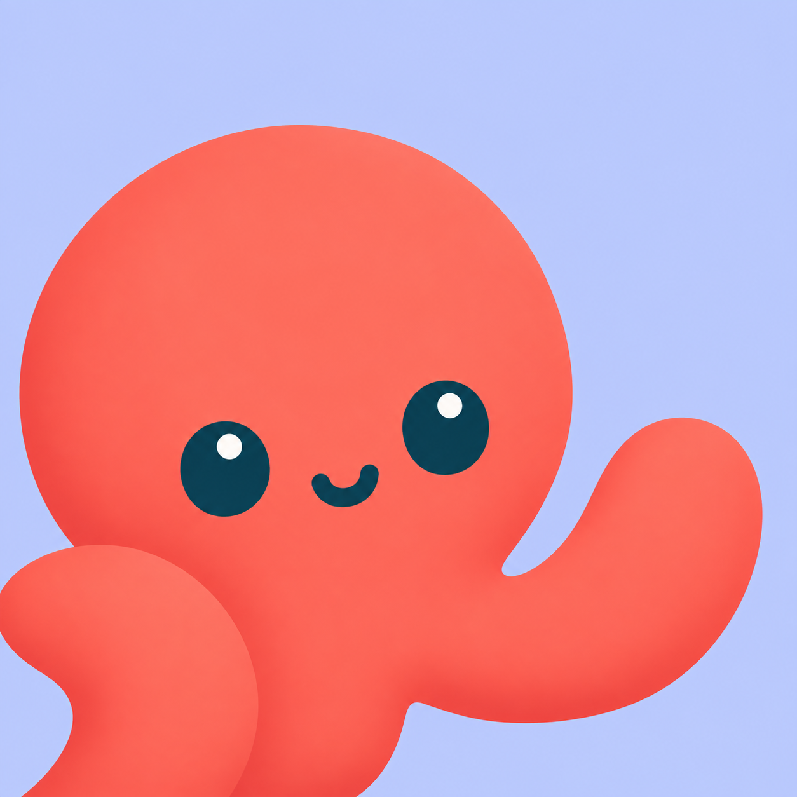

<p align="center">
  
</p>

<h1 align="center">Kumu</h1>

<p align="center">
  把本地编码 Agent 装进一个 macOS 工作区。<br>
  一个项目一个布局，一个窗格一个 Agent 的原生终端界面。
</p>

<p align="center">
  <a href="https://github.com/yankewei/kumu/releases/latest">下载</a> ·
  <a href="#从源码构建">从源码构建</a> ·
  <a href="docs/agent-notifications.md">通知文档</a>
</p>

<p align="center">
  <a href="https://github.com/yankewei/kumu/actions/workflows/ci.yml"></a>
  
  <a href="https://github.com/yankewei/kumu/releases/latest"></a>
</p>

Kumu 是一个 macOS 终端工作区，用来同时跑多个本地编码 Agent。左侧是项目列表，右侧是可按任意方向拆分的终端网格，每个窗格直接运行 Agent 自己的 TUI，而不是另做一层聊天界面。切换项目不会打断后台的终端；重新打开应用时，窗格会接回原来的对话。

支持 Codex、Claude Code、OpenCode、Pi、Oh My Pi、Cursor CLI 和 Grok Build。

## 安装

Kumu 目前只提供 **Apple Silicon Mac** 安装包，系统要求 macOS 11 或更高版本。

1. 从 [Releases](https://github.com/yankewei/kumu/releases/latest) 下载 `Kumu-<版本>-<架构>.dmg`。
2. 打开 DMG，把 **Kumu.app** 拖进 **Applications**。
3. 从应用程序目录启动 Kumu。

安装包自带运行时，不需要安装 Rust 或 Zig；编码 Agent 仍需自行安装，并按各自的要求登录或配置。

Kumu 会在启动时检查更新，也可以在设置里手动检查。新版本在后台下载并安装，确认重启后生效；重启会结束当前的终端进程。

## 把项目放在一起

Kumu 把每个项目当作独立工作区：它有各自的分屏布局和终端进程。切换项目只是切换显示，后台的 Agent 继续运行；关闭窗格或删除项目才会结束进程。

- 点击侧栏 `+` 添加项目目录，Kumu 会立即在该目录下开一个终端。
- 右键项目可以新建终端、重命名、删除、在 Finder 中打开，或复制路径和名称。
- 在 Git 仓库上右键可以按分支创建 worktree，也可以列出现有 worktree 并加入侧栏。worktree 是仓库同级的 `<仓库>-<分支>` 目录，会作为子项目出现在侧栏；从 Kumu 移除它不会删除磁盘上的目录。
- 右上角的 Git 按钮打开右侧面板，显示当前项目的分支和全部提交历史（类似 `git log`），切换项目时跟随当前选择，新提交出现后自动刷新；支持按提交信息搜索，悬停某条提交可以查看完整提交说明、正文和作者。
- 拖动侧栏分隔线可以调整宽度。
- 重新打开应用时恢复窗口位置、分屏比例、选中的项目、焦点窗格和 Agent 对话。

同时最多保留 12 个活动终端；超出时按最久未显示的顺序停掉后台窗格，再切回去时重新启动 shell 或恢复 Agent 对话。屏幕上正在显示的窗格不会被停掉。

## 让 Agent 各占一格

- 点击窗格标题栏的 Agent 按钮，可以直接新建一个运行指定 Agent 的窗格。
- 也可以在普通 shell 里照常输入 `codex`、`claude`、`opencode`、`pi`、`omp` 等命令，Kumu 一样能识别它属于哪个 Agent。
- 窗格记住 Agent 侧的会话 id，重启后按该 CLI 的 resume 语法接回同一个对话：

| Agent | 恢复方式 |
| --- | --- |
| Codex | `codex resume <id>` |
| Claude Code | `claude --resume <id>` |
| OpenCode | `opencode --session <id>` |
| Cursor CLI | `cursor --resume <id>` |
| Pi、Oh My Pi、Grok Build | 暂不恢复，以新对话开始 |

恢复功能可在 **设置 → 通用 → 恢复 Agent 会话** 关闭。Agent 退出后窗格会变回普通 shell；在 shell 里手动启动的 Agent 也会被接管，同样支持下次恢复。

## 终端

| 操作 | 快捷键 |
| --- | --- |
| 向右分屏 | `⌘D` |
| 向下分屏 | `⌘⇧D` |
| 在窗格间移动焦点 | `⌘⌥←/→/↑/↓` |
| 在当前窗格中查找 | `⌘F` |
| 在查找结果间跳转 | `Enter` / `⇧Enter` |

`⌘F` 会搜索当前窗格的输出和回滚内容，`Esc` 关闭查找条。关闭最后一个终端后项目仍会保留，可以随时新建。

## 不错过需要你的时刻

Agent 完成任务、等待输入或请求确认时，Kumu 会提醒你：前台时用应用内提醒，后台时发 macOS 系统通知；没看的那次会在项目上留下未读标记，点击通知可直接回到对应终端。

通知接入在 **设置 → 服务商 → 编码 Agent** 中按 Agent 开启，开启后需要重启该 Agent。Kumu 只把自己的处理器注册到 Agent 原有的配置或自动发现目录，不改写启动命令，也不覆盖已有 hooks 和注释；再次点击同一位置即可移除。Codex 还需要在 `/hooks` 中审查并信任新增的 hooks。

系统通知要求从 `.app` 启动，并在首次提醒时允许通知。可以运行下面的命令测试，然后切到别的终端、项目或应用：

```sh
sleep 3; printf '\033]9;任务完成\007'
```

各 Agent 的注册位置、事件来源和实现细节见 [Agent 通知接入说明](docs/agent-notifications.md)。

## 数据与隐私

项目、布局和设置保存在本机 SQLite 数据库 `~/.kumu/kumu.db`。Kumu 不收集使用数据，除检查更新和下载安装包外不访问网络。

## 从源码构建

需要 macOS、Xcode、Rust 和 Zig 0.17。仓库包含 Ghostty 子模块，克隆时一并拉取：

```bash
git clone --recurse-submodules https://github.com/yankewei/kumu.git
cd kumu
cargo run
```

如果克隆时漏了子模块，先运行 `git submodule update --init --recursive`。

构建可双击启动的 `.app`（通知和更新需要真实的应用包）：

```bash
packaging/make-app.sh release --open
```

可分发 DMG 与签名、公证流程见 `.agents/skills/release-macos/SKILL.md`，由 `packaging/release.sh` 执行。

## 文档

- [Agent 通知接入说明](docs/agent-notifications.md)
- 开发约定、技术栈与发布流程见 [AGENTS.md](AGENTS.md)
