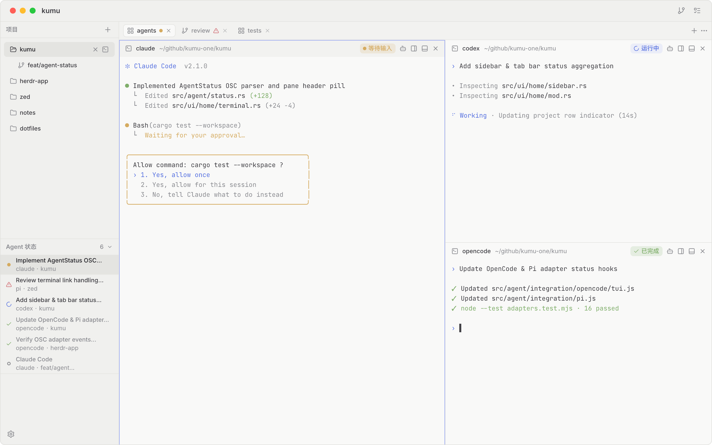
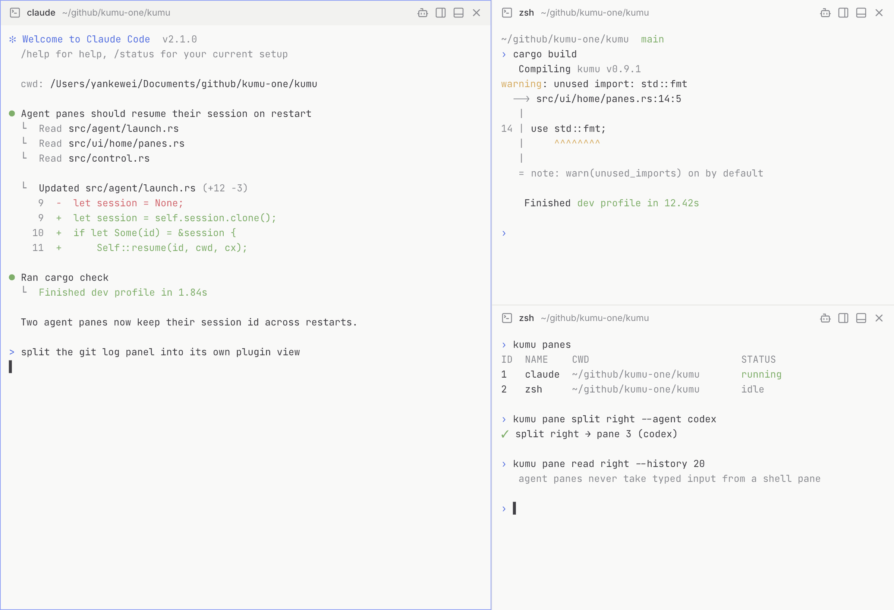
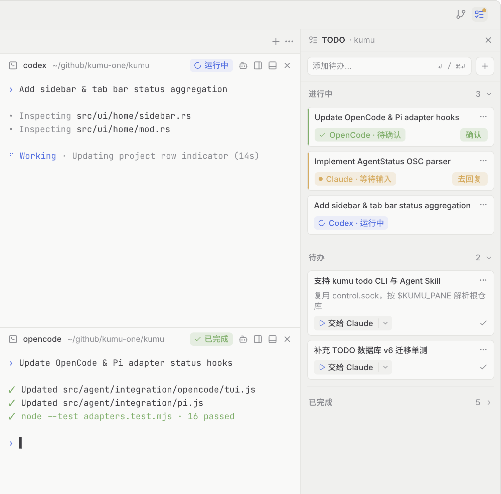
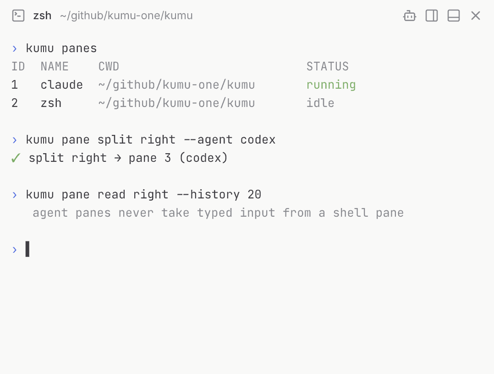

<p align="center">
  
</p>

<h1 align="center">Kumu</h1>

<p align="center">
  基于 libghostty 与 GPUI 的原生 macOS 工作区，为多编码 Agent 并行开发而建。
</p>

<p align="center">
  <a href="https://github.com/yankewei/kumu/releases/latest">
    
  </a>
</p>

<p align="center">
  <a href="https://github.com/yankewei/kumu/actions/workflows/ci.yml"></a>
  
  <a href="https://github.com/yankewei/kumu/releases/latest"></a>
</p>

<p align="center">
  <a href="#核心特性">核心特性</a> ·
  <a href="#支持的编码-agent">支持的 Agent</a> ·
  <a href="#安装">安装</a> ·
  <a href="#命令行控制">命令行控制</a> ·
  <a href="#快捷键">快捷键</a> ·
  <a href="#faq">FAQ</a> ·
  <a href="docs/agent-notifications.md">通知文档</a>
</p>

<p align="center">
  
</p>

<p align="center">
  <sub>一个项目一套分屏布局，一个窗格一个 Agent 的原生终端界面。支持 Claude Code、Codex、OpenCode、Antigravity CLI、Cursor CLI、Pi、Oh My Pi 与 Grok Build。</sub>
</p>

---

## 核心特性

<table>
<tr>
<td width="40%" valign="middle">
<h3>全局 Agent 状态与精准提醒</h3>
侧边栏按优先级汇总所有项目与页签中的活动 Agent（等待输入、执行失败优先置顶，支持折叠为状态摘要条），点击可跨项目、跨页签直达对应窗格；窗格标题栏展示状态胶囊，等待输入、执行失败会在 Agent 行和页签持续提示到状态解除，任何未查看的状态变更还会点亮项目行、折叠侧边栏按钮和窗格胶囊，查看后清除。<br><br>
Agent 需要确认、等待输入或完成任务时，前台弹应用内提醒、后台发 macOS 系统通知，点击直接回到对应窗格。
</td>
<td width="60%">

</td>
</tr>
<tr>
<td width="40%" valign="middle">
<h3>多项目、多页签与任意分屏</h3>
每个项目拥有独立的多页签工作区（支持重命名，关闭多窗格页签前会确认），每个页签是一整套可任意横向、纵向拆分的终端网格；当前激活窗格以蓝色细边框标识，每个窗格直接运行 Agent 原生 TUI。<br><br>
切换项目或页签不会打断后台终端；重新打开应用时自动恢复窗口位置、分屏比例、页签与 Agent 对话。
</td>
<td width="60%">

</td>
</tr>
<tr>
<td width="40%" valign="middle">
<h3>TODO 看板与 Agent 双向联动</h3>
右侧 TODO 看板按根仓库隔离（Git Worktree 自动共享父仓库看板），支持快捷输入（<code>↵</code> 添加、<code>⌘↵</code> 添加并派发）与跨泳道拖拽。待办卡片可一键右侧分屏或新建页签派发给指定 Agent，也可绑定已有窗格；进行中的卡片实时同步状态，点击可跳转、回复、在侧栏内联编辑或追加指令、确认归档。<br><br>
Agent 也能通过内置 CLI 自行认领待办并在完成后标记为「待确认」。
</td>
<td width="60%">

</td>
</tr>
<tr>
<td width="40%" valign="middle">
<h3>Agent 跨窗格协作</h3>
Kumu 向每个窗格注入 <code>KUMU_APP_BINARY</code> 与 <code>KUMU_PANE</code>，让一个 Agent 可以读取其它窗格的输出与滚动历史、在旁边拆分出新 Agent 窗格并下发 prompt，或继续向已有 Agent 窗格发消息。<br><br>
安装配套 Skills 后，只需用自然语言说「让右边开个 Codex review 改动」，Agent 就会自己调用。
</td>
<td width="60%">

</td>
</tr>
</table>

- **Git 历史、分支总览与 Diff 行级审查** — 右上角打开 Git 面板查看当前分支、相对默认分支（`main`/`master`）的整条分支 Diff 总览、提交历史（支持搜索与悬停看完整信息）及工作区改动 diff；在 diff 任意行点 `+` 写审查意见，指定目标窗格后连同文件、行号与上下文一键发给 Agent（未发出的草稿自动保留，补丁变更时提示重新读取；焦点在普通 shell 时仅粘贴不执行）。
- **原生 Git Worktree 全生命周期管理** — 在 Git 仓库右键按分支创建或导入同级 `<仓库>-<分支>` worktree，支持从 TODO 卡片一键新建 Worktree 并派发 Agent；任务完成后可选择「从列表移除（保留目录）」或「删除 worktree（带未提交改动检查并清理磁盘目录）」。
- **自动接管、会话恢复与自定义启动参数** — 无论是通过窗格按钮新建，还是在普通 shell 里手动输入 `claude`、`codex`、`opencode`、`agy` 等命令启动，Kumu 都会自动识别并在下次打开应用时按原 CLI 语法接回同一段对话；可在 **设置 → 服务商 → 编码 Agent** 为各已安装 Agent 配置默认启动参数。
- **高性能原生架构** — 使用 Rust + Pure Rust NSH + GPUI 构建原生界面，内嵌 Ghostty (`libghostty`) 终端渲染引擎，轻快流畅、无 Electron 开销。
- **亮暗主题、字体定制与源码跳转** — 支持亮色 / 深色外观切换与自定义字体字号；终端内支持 `⌘ + 点击` 直接打开网页链接及 `file:line:col` 本地源码路径（自动调用 Zed / Cursor / VS Code 等编辑器并定位到行列）。
- **本地优先、隐私安全** — 所有项目、布局、TODO 与设置仅存放在本机 `~/.kumu/kumu.db`，不上传代码、不收集使用数据。

---

## 支持的编码 Agent

| Agent | 自动识别 | 重启恢复对话 | 状态追踪与通知 |
| --- | :---: | --- | --- |
| **Claude Code** | ✅ | `claude --resume <id>` | 运行中 / 等待权限与提问 / 完成 |
| **Codex** | ✅ | `codex resume <id>` | 运行中 / 等待权限与提问 / 完成（需在 `/hooks` 信任） |
| **OpenCode** | ✅ | `opencode --session <id>` | 运行中 / 等待输入 / 完成 / 失败（自动发现插件） |
| **Antigravity CLI** | ✅ | `agy --conversation <id>` | 运行中 / 完成 / 失败 |
| **Cursor CLI** | ✅ | `cursor --resume <id>` | 任务结束通知 |
| **Pi** | ✅ | 暂不支持（以新对话启动） | 运行中 / 等待输入 / 完成（扩展自动发现） |
| **Oh My Pi** | ✅ | 暂不支持（以新对话启动） | 运行中 / 等待权限与输入 / 完成（扩展自动发现） |
| **Grok Build** | ✅ | 暂不支持（以新对话启动） | 任务结束与通知 |

- 会话恢复可在 **设置 → 通用 → 恢复 Agent 会话** 关闭；Agent 退出后窗格自动回到普通 shell。
- 状态追踪与通知在 **设置 → 服务商 → 编码 Agent** 按 Agent 一键开启或移除（开启后重启该 Agent 生效）。Kumu 不改写启动命令，也不覆盖已有 hooks 和注释；各 Agent 的注册路径与实现细节见 [Agent 通知接入说明](docs/agent-notifications.md)。

---

## 安装

Kumu 目前提供 **Apple Silicon Mac** 安装包，系统要求 **macOS 11** 或更高版本。

1. 从 [Releases](https://github.com/yankewei/kumu/releases/latest) 下载 `Kumu-<版本>-<架构>.dmg`。
2. 打开 DMG，将 **Kumu.app** 拖入 **Applications**。
3. 从应用程序目录启动 Kumu（首次收到后台通知时请允许通知权限）。

安装包自带运行时，无需安装 Rust 或 Zig；编码 Agent CLI 需自行安装并完成登录。Kumu 会在启动时检查更新（也可在设置中手动检查），后台下载后经确认重启生效。

### 安装配套 Agent Skills（推荐）

让你的编码 Agent 原生学会操作 Kumu 窗格与 TODO 看板：

```sh
npx skills add yankewei/kumu
```

包含两个 skill：
- [`kumu-panes`](skills/kumu-panes/SKILL.md)：读取其它窗格内容、在旁边拆分新 Agent 窗格、向 Agent 窗格发消息。
- [`kumu-todos`](skills/kumu-todos/SKILL.md)：查看、新建、认领当前仓库的 TODO 卡片，并在完成后提交验收。

---

## 命令行控制

在 Kumu 的任意窗格内，可以直接通过环境变量 `$KUMU_APP_BINARY` 调用控制命令（通过仅限当前用户访问的 `~/.kumu/control.sock` 通信）：

```sh
# 窗格查看、读取与跨窗格协作
"$KUMU_APP_BINARY" panes                                          # 列出所有窗格（id、项目、标题、cwd、尺寸）
"$KUMU_APP_BINARY" pane read right --history 200 --tail 60        # 读取右侧窗格滚动历史与当前屏幕
"$KUMU_APP_BINARY" pane scroll up right                           # 向上滚动右侧窗格（支持主屏和全屏 TUI）
"$KUMU_APP_BINARY" pane split right --agent codex --prompt "review 所有改动"
"$KUMU_APP_BINARY" pane wait right --timeout 300                  # 阻塞等待右侧 Agent 完成或等待输入
"$KUMU_APP_BINARY" pane send right "继续，把测试也补上"
"$KUMU_APP_BINARY" pane close right                               # 关闭临时子窗格

# 操作当前仓库的 TODO 看板（Worktree 自动关联父仓库）
"$KUMU_APP_BINARY" todo list --json
"$KUMU_APP_BINARY" todo update 12 --status in_progress --bind     # 认领任务并绑定当前窗格
"$KUMU_APP_BINARY" todo review 12                                 # 标记为待确认，等待验收
```

- 窗格目标支持 `left` / `right` / `up` / `down`（相对当前窗格）、`focused`、`current` 或 `panes` 中的数字 id。
- `pane split` 支持向右（`right`）或向下（`down`），新建时保持原窗格键盘焦点不变，`--prompt` 会等待新 Agent 画出输入框后自动发送。
- `pane send` 仅允许发送给 Agent 窗格，普通 shell 窗格会拒绝（防止误执行命令）；更多参数与边界说明见 [`kumu-panes`](skills/kumu-panes/SKILL.md) 与 [`kumu-todos`](skills/kumu-todos/SKILL.md)。

---

## 快捷键

| 操作 | 快捷键 |
| --- | --- |
| 打开/关闭快捷命令面板（跳 Agent / 项目 / 页签 / 命令） | `⌘K` |
| 折叠/展开左侧边栏 | `⌘B` |
| 打开设置 | `⌘,` |
| 新建页签 | `⌘T` |
| 关闭页签（结束该布局内所有终端） | `⌘W` |
| 关闭当前聚焦窗格 | `⌘⇧W` |
| 切换页签 | `⌘⇧[` / `⌘⇧]` 或 `⌘1`…`⌘9` |
| 向右分屏 | `⌘D` |
| 向下分屏 | `⌘⇧D` |
| 最大化/还原当前分屏窗格 | `⌘⇧Enter` |
| 在窗格间移动焦点 | `⌘⌥← / → / ↑ / ↓` |
| 放大 / 缩小 / 重置字号 | `⌘+` / `⌘-` / `⌘0` |
| 在当前窗格中查找（含滚动历史） | `⌘F` |
| 在查找结果间跳转 / 关闭查找条 | `Enter` / `⇧Enter` / `Esc` |
| 打开终端中的链接 | `⌘ + 点击` |
| TODO 快捷输入：添加 / 添加并派发 | `Enter` / `⌘Enter` |

---

## 从源码构建

需要 macOS、Xcode、Rust 和 **Zig 0.17**。仓库包含 Ghostty 子模块，克隆时需一并拉取：

```bash
git clone --recurse-submodules https://github.com/yankewei/kumu.git
cd kumu
cargo run
```

如果克隆时漏拉了子模块，先执行 `git submodule update --init --recursive`。

构建可双击启动的 `.app`（系统通知与自动更新需要完整的应用包）：

```bash
packaging/make-app.sh release --open
```

可分发 DMG 的签名、公证与发布流程由 `packaging/release.sh` 执行，详见 [`.agents/skills/release-macos/SKILL.md`](.agents/skills/release-macos/SKILL.md)。

---

## FAQ

### Kumu 和 Ghostty 是什么关系？
Kumu 不是 Ghostty 的 fork，而是通过 [`libghostty`](https://github.com/ghostty-org/ghostty) 将 Ghostty 作为底层终端引擎嵌入，并在其上用 Rust + GPUI 构建专为多编码 Agent 协作设计的 macOS 工作区。

### 后台开很多项目和页签会很占内存吗？
Kumu 最多同时保留 12 个活动终端；超出时按最久未显示的顺序自动回收后台窗格（当前屏幕可见的窗格不会被回收），再次切回时会自动重新启动 shell 或按会话 id 恢复 Agent 对话。

### 为什么没有收到 macOS 系统通知横幅？
系统通知要求从 `.app` 应用包启动（`cargo run` 裸二进制不会触发系统横幅），且在首次提醒时允许通知。你可以运行下面的命令并切到后台测试通知链路：

```sh
sleep 3; printf '\033]9;任务完成\007'
```

更多排查细节与各 Agent 事件覆盖范围见 [Agent 通知接入说明](docs/agent-notifications.md)。

### 同时打开两个 Kumu 实例会互相干扰吗？
不会。控制通道 `~/.kumu/control.sock`（目录 `0700`、socket `0600`）仅由首个实例持有；第二个实例不会接管它，其窗格里的控制命令会直接报错，避免误操作第一个实例的窗格。

### 数据存在哪里？会联网吗？
项目、布局、TODO 和设置全部保存在本机 SQLite 数据库 `~/.kumu/kumu.db`。除检查更新和下载安装包外，Kumu 不访问网络，也不收集任何使用数据。

### 遇到问题需要日志怎么办？
从 Finder 启动时 Kumu 没有可读的 stderr，因此会把诊断日志写到 `~/Library/Logs/Kumu/kumu.log`（超过 5 MB 轮转为 `kumu.log.1`）。在终端里直接运行 `cargo run` 时仍输出到 stderr；设置 `KUMU_LOG_TO_FILE=1` 可强制写文件。

---

## 文档

- [Agent 通知接入说明](docs/agent-notifications.md)
- [窗格控制 Skill（`kumu-panes`）](skills/kumu-panes/SKILL.md)
- [TODO 看板 Skill（`kumu-todos`）](skills/kumu-todos/SKILL.md)
- [开发约定与技术栈（`AGENTS.md`）](AGENTS.md)

## License

[MIT](LICENSE)
