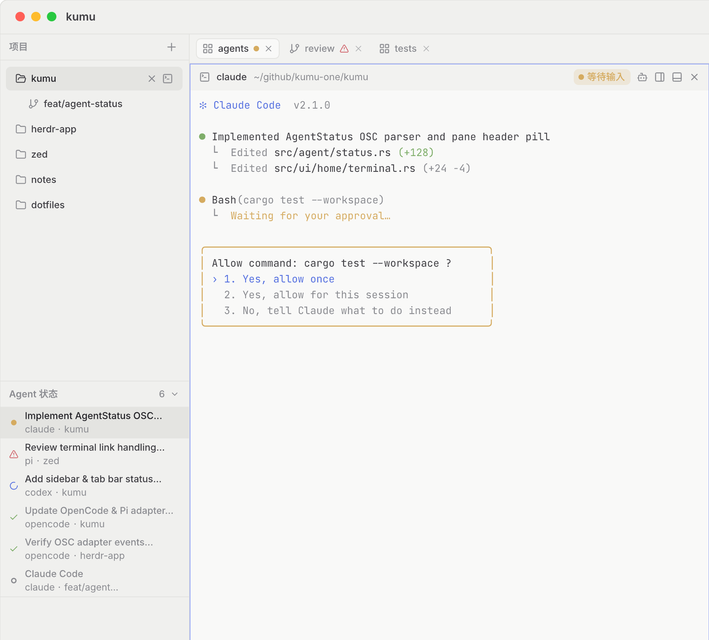

<p align="center">
  
</p>

<h1 align="center">Kumu</h1>

<p align="center">
  <strong>把多个终端 AI 编码助手，放进同一个原生 macOS 工作区。</strong><br>
  基于 Rust + GPUI + libghostty 构建，轻快流畅、本地优先，专为多 Agent 并行开发打造。
</p>

<p align="center">
  <a href="https://github.com/yankewei/kumu/releases/latest">
    
  </a>
</p>

<p align="center">
  <a href="https://github.com/yankewei/kumu/actions/workflows/ci.yml"></a>
  
  <a href="https://github.com/yankewei/kumu/releases/latest"></a>
  <a href="LICENSE"></a>
</p>

<p align="center">
  <a href="#30-秒快速上手">快速上手</a> ·
  <a href="#为什么用-kumu">核心功能</a> ·
  <a href="#支持的编码-agent">支持的 Agent</a> ·
  <a href="#常用快捷键">快捷键</a> ·
  <a href="#进阶cli-与-mcp">CLI & MCP</a> ·
  <a href="#faq">FAQ</a>
</p>

<p align="center">
  
</p>

<p align="center">
  <sub>保留每个 Agent 原汁原味的终端 TUI。原生支持 Claude Code、Codex、OpenCode、Antigravity CLI、Cursor CLI、Pi、Oh My Pi 与 Grok Build。</sub>
</p>

---

## 30 秒快速上手

> **系统要求**：Apple Silicon Mac，macOS 11+。无需安装 Rust、Zig 或 Node；编码 Agent CLI 需自行安装并登录。

### 1. 下载安装
前往 [Releases](https://github.com/yankewei/kumu/releases/latest) 下载 `Kumu-<版本>-arm64.dmg`，将 **Kumu.app** 拖入 **Applications** 并打开。

### 2. 一键接入本机 Agent
首次打开 Kumu 会自动弹出 **4 步新手引导**（随时可通过 `⌘K` →「打开新手引导」重开），带你完成：
- 自动检测并一键接入本机已安装的编码 Agent（**通知 + MCP + Skills 一次配齐**）；
- 开启并测试 macOS 后台通知权限；
- 选择项目目录、打开第一个 Agent 窗格并预览 Artifacts 阅读页。

如果你更习惯命令行，也可以直接在终端运行一句：

```sh
kumu integration install
```

### 3. 直接开干
按 `⌘D` 多拆几个窗格，直接用自然语言让不同 Agent 协同工作：
- *「在右侧开一个 codex 窗格，让它 review 一下我当前的 git diff」*
- *「帮我写一份登录页重构方案，发布到 Kumu artifacts 给我看」*
- *「做一个可交互的 HTML 原型，发到 artifacts」*

---

## 为什么用 Kumu？

<table>
<tr>
<td width="40%" valign="middle">
<h3>一眼看清所有 Agent 状态</h3>
同时开 5 个 Agent 再也不用切来切去翻终端。<br><br>
侧边栏按优先级汇总所有项目里的活动 Agent（<strong>等待确认</strong>、<strong>执行失败</strong>自动置顶），点击直达对应窗格；后台运行结束或需要你点确认时，自动发 macOS 系统通知。
</td>
<td width="60%">

</td>
</tr>
<tr>
<td width="40%" valign="middle">
<h3>多项目、多页签、任意分屏</h3>
每个项目拥有独立页签与横纵分屏网格，每个窗格直接运行原生 Agent TUI，不阉割任何快捷键与交互。<br><br>
切换项目不中断后台进程；重启 App 自动恢复窗口布局、分屏比例与 Agent 上次对话。
</td>
<td width="60%">

</td>
</tr>
<tr>
<td width="40%" valign="middle">
<h3>让 Agent 之间互相协作</h3>
接入内置 MCP 与 Skills 后，一个 Agent 可以读取相邻窗格的输出、在旁边拆分新 Agent 派发任务、阻塞等待结果，甚至做多 Agent 代码审查。
</td>
<td width="60%">

</td>
</tr>
</table>

### 更多开箱即用的能力

- **Artifacts 可视化阅读**：Agent 生成的方案、报告或 HTML 原型自动归档到右侧 **Artifacts** 抽屉，Markdown 原生排版、HTML 内嵌 WebView 直接交互，不再在终端里滚动几千行文本。
- **内置 MCP + Skills，外部零污染**：内置标准 MCP Server 与 `kumu-panes` / `kumu-artifacts` Skills，随 Kumu 版本自动同步；在外部终端或 IDE 中静默不暴露工具，不浪费上下文 token。
- **Git 历史与行级 Diff 审查**：右上角一键查看分支总览、提交历史与工作区改动；在 diff 任意行点 `+` 写审查意见，连同文件名、行号与代码上下文一键发给指定 Agent 窗格。
- **Git Worktree 管理**：在仓库右键按分支一键创建或导入 worktree，让多个 Agent 在隔离目录并行开发；完成后支持一键安全清理。
- **原生性能与本地隐私**：Rust + GPUI + `libghostty` 原生构建，无 Electron 内存开销；所有数据仅存在本机 `~/.kumu/kumu.db`，不上传代码、不收集遥测。

---

## 支持的编码 Agent

| Agent | 通知与状态 | 会话自动恢复 | MCP 工具 | 内嵌 Skills |
| --- | :---: | --- | :---: | :---: |
| **Claude Code** | ✅ | `claude --resume <id>` | ✅ | ✅ |
| **Codex** | ✅（需在 `/hooks` 信任） | `codex resume <id>` | ✅ | ✅ |
| **OpenCode** | ✅（自动发现插件） | `opencode --session <id>` | ✅ | ✅ |
| **Antigravity CLI** | ✅ | `agy --conversation <id>` | ✅ | ✅ |
| **Cursor CLI** | ✅ | `cursor --resume <id>` | ✅ | ✅ |
| **Grok Build** | ✅ | 新对话启动 | ✅ | ✅ |
| **Pi** | ✅（自动发现扩展） | 新对话启动 | 原生扩展 | ✅ |
| **Oh My Pi** | ✅（自动发现扩展） | 新对话启动 | 原生扩展 | ✅ |

> 即使你在普通 Shell 窗格里手动输入 `claude`、`codex`、`opencode`、`agy` 启动，Kumu 也会自动识别并接管状态与会话恢复。

---

## 常用快捷键

| 操作 | 快捷键 |
| --- | --- |
| 快捷命令面板（跳 Agent / 项目 / 页签 / 重开引导） | `⌘K` |
| 向右分屏 / 向下分屏 | `⌘D` / `⌘⇧D` |
| 最大化 / 还原当前窗格 | `⌘⇧Enter` |
| 窗格间移动焦点 | `⌘⌥← / → / ↑ / ↓` |
| 新建 / 关闭页签 | `⌘T` / `⌘W` |
| 关闭当前窗格 | `⌘⇧W` |
| 折叠 / 展开左侧边栏 | `⌘B` |
| 终端内查找（含滚动历史） | `⌘F` |
| 放大 / 缩小 / 重置字号 | `⌘+` / `⌘-` / `⌘0` |
| 打开设置 | `⌘,` |
| 点击终端链接 / 跳转 `file:line:col` 到编辑器 | `⌘ + 点击` |

---

## 进阶：CLI 与 MCP

在 Kumu 窗格中，环境变量 `$KUMU_APP_BINARY` 指向 Kumu 本体，`$KUMU_PANE` 指向当前窗格 ID。

### 统一接入管理

```sh
kumu integration install          # 为本机已安装的 Agent 一键配置通知 + MCP + Skills
kumu integration install claude   # 指定单个 Agent（支持 claude-code / agy / antigravity 等别名）
kumu integration status           # 查看各 Agent 的通知、MCP、Skills 接入状态（支持 --json）
kumu integration uninstall        # 卸载全部已接入项
```

<details>
<summary><strong>展开查看窗格控制与 Artifacts 常用命令</strong></summary>

```sh
# 跨窗格控制
"$KUMU_APP_BINARY" panes                                          # 列出所有窗格
"$KUMU_APP_BINARY" pane read right --history 200 --tail 60        # 读取右侧窗格内容
"$KUMU_APP_BINARY" pane scroll up right                           # 滚动全屏 TUI（如 OpenCode / Claude）
"$KUMU_APP_BINARY" pane split right --agent codex --prompt "review 当前改动"
"$KUMU_APP_BINARY" pane wait right --timeout 300                  # 等待目标 Agent 完成或等待输入
"$KUMU_APP_BINARY" pane send right "把单测也补上"                  # 仅允许发给 Agent 窗格
"$KUMU_APP_BINARY" pane close right

# 发布与管理 Artifacts
"$KUMU_APP_BINARY" artifact publish ./plan.md --title "登录页重构方案"
"$KUMU_APP_BINARY" artifact publish ./mockup.html --title "交互原型" --open
"$KUMU_APP_BINARY" artifact publish ./plan.md --replace <ARTIFACT_ID>
"$KUMU_APP_BINARY" artifact list
```

</details>

<details>
<summary><strong>从源码构建（开发者）</strong></summary>

需要 macOS、Xcode、Rust 和 **Zig 0.17**：

```bash
git clone --recurse-submodules https://github.com/yankewei/kumu.git
cd kumu
cargo run
```

构建完整 `.app`（系统通知与自动更新需要 `.app` 应用包）：

```bash
packaging/make-app.sh release --open
```

签名、公证与发布 DMG 见 [`.agents/skills/release-macos/SKILL.md`](.agents/skills/release-macos/SKILL.md)。

</details>

---

## FAQ

<details>
<summary><strong>Kumu 和 Ghostty 是什么关系？</strong></summary>

Kumu 不是 Ghostty 的 fork，而是通过 [`libghostty`](https://github.com/ghostty-org/ghostty) 将 Ghostty 嵌入为底层终端渲染引擎，再在其上用 Rust + GPUI 构建专为多编码 Agent 协作设计的原生 macOS 工作区。
</details>

<details>
<summary><strong>开很多项目和页签会很占内存吗？</strong></summary>

不会。Kumu 最多同时保持 12 个活动终端，超出时按最久未显示顺序自动回收后台窗格（当前可见窗格不回收）；切回时自动恢复 shell 或按原会话 ID 接回 Agent 对话。
</details>

<details>
<summary><strong>为什么没有收到 macOS 系统通知横幅？</strong></summary>

macOS 系统通知要求从打包后的 `Kumu.app` 启动（`cargo run` 裸二进制不会弹横幅），并在系统设置中允许 Kumu 发送通知。可在引导第 2 步点击「发送测试通知」或切到后台运行 `sleep 3; printf '\033]9;任务完成\007'` 验证。
</details>

<details>
<summary><strong>我的代码和数据会被上传吗？</strong></summary>

不会。项目、布局和设置全部保存在本机 `~/.kumu/kumu.db`，Artifacts 保存在项目本地 `.kumu/artifacts/`（默认被 `.gitignore` 忽略）。除检查更新外，Kumu 不主动联网，也不收集任何遥测数据。
</details>

<details>
<summary><strong>遇到问题去哪里找日志？</strong></summary>

从 Finder 启动时，诊断日志保存在 `~/Library/Logs/Kumu/kumu.log`（超过 5 MB 自动轮转为 `kumu.log.1`）。
</details>

---

## 相关文档

- [Agent 统一接入 CLI（Hooks + MCP + Skills）](docs/agent-integration-cli.md)
- [Agent 通知接入原理](docs/agent-notifications.md)
- [Artifacts 可视化产物设计](docs/artifact-rendering.md)
- [桌面端新手引导设计](docs/onboarding-guide.md)
- [窗格控制 Skill（`kumu-panes`）](skills/kumu-panes/SKILL.md) · [产物发布 Skill（`kumu-artifacts`）](skills/kumu-artifacts/SKILL.md)

## License

[MIT](LICENSE)
